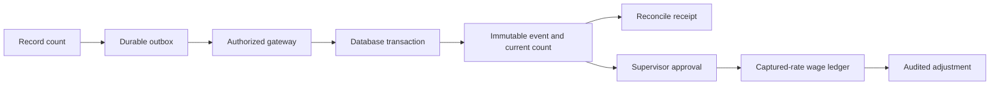

# Architecture

The current application supports one business per Supabase backend. Lines belong
to that business and are not separate owners.

| Path | Responsibility |
| --- | --- |
| `src/app/` | Root layout, login, setup links, shell and not-found |
| `src/ui/AppShell.tsx` | Role navigation, router query parameters and account controls |
| `src/ui/Workflows.tsx`, `DayPlan.tsx`, `Catalog.tsx` | Counts, approvals, planning, staff and catalogs |
| `src/ui/Admin*.tsx`, `ProductionView.tsx`, `LineDetail.tsx` | Overview, inbox, production/pay and line details |
| `src/domain/` | Rules, types, ledger, pricing, reconciliation and navigation |
| `src/lib/daily-store.tsx` | Session/snapshot state, local captures, sync and actions |
| `src/lib/storage.ts`, `storage.web.ts` | SQLite and IndexedDB outboxes |
| `src/lib/supabase.ts`, `phone.ts` | Client and credential storage |
| `src/lib/i18n.ts`, `src/locales/` | Formatting, fonts and bundled translations |
| `supabase/migrations/`, `supabase/functions/` | Trusted data rules, device gateway and push |
| `plugins/`, `scripts/` | Native configuration, provisioning and build tools |

Each change has a unique ID and assignment context. Saving precedes the display
update. Uploads preserve order and batch up to 40 events. Duplicate IDs do not
count twice. Temporary failures back off; permanent errors remain for attention.
Logout and phone replacement are guarded while unsent changes remain. Sync runs
in the foreground rather than an always-running background service.

Captains approve unchanged quantities and attendance. Corrections retain
originals and add adjustments. Rates are integer paise; dates use Asia/Kolkata.
Automatic rates round standard seconds / 60 times the configured minute rate.

Admin uses Supabase Auth. Staff uses a random credential from `device-access`,
stored as a hash server-side. Staff login currently needs only ID/phone; see
SECURITY.md. Admins use authenticated RPCs; gateway/database checks authorize
staff actions. Never place a service-role key in the client.

Global admin checks, style catalogs and singleton factory/rate settings make
this a single-business model. Unit checks constrain staff but cannot isolate
unrelated companies.

Known boundaries: earnings are not payment records; count dates are today and
two days earlier; much snapshot history is trimmed to roughly 62 days; capture
intervals measure elapsed time between additions rather than active sewing;
language tests cannot certify translation quality. Some legacy screens and RPCs
remain outside normal navigation. See the platform plan for the proposed changes.
