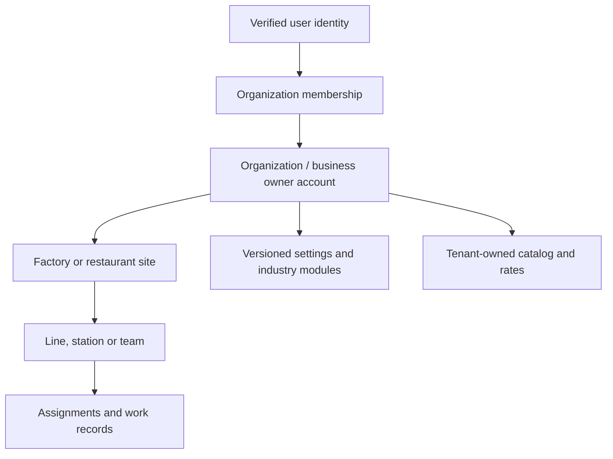

# Crewgrain: open-source and shared-platform plan

Author: BiswasSekhar. Prepared 17 November 2026 from the existing source.
Status: implementation proposal, not shipped multi-tenant behavior.

## Decisions from the owner

- Publish a new public repository under `BiswasSekhar`; keep Ziva separate.
- Target one shared platform with isolated factory-owner accounts first.
- Publish reproducible setup, backend options, workflow automation and upgrade
  instructions so operators can host and extend the product.
- Grow from garment work into additional industries, including restaurants.

Crewgrain is the selected public working name. A preliminary exact-name web and
GitHub repository search found no obvious existing software repository under that
name; this is not trademark/domain clearance. MIT preserves the existing license
and permits adoption/customization. Upstream notices remain.

## Product boundary

The common product is work planning, assignment, completion records, approval,
audit and operational reporting. Piece-rate pay is an optional garment module.
Restaurants need prep tasks, batches, checklist and shift-completion workflows;
these differ from sewing counters. POS, billing, food inventory, recipes,
purchasing, statutory payroll and regulatory certification are separate future
modules, not implied by a restaurant preset.

Keep a reliable small core. Start with two demonstrated workflows rather than
building an unrestricted workflow engine or promising support for every industry.

## Existing obstacles with source evidence

| Existing implementation | Consequence for shared hosting |
| --- | --- |
| `private.is_admin()` / `private.can_unit()` in migration 001 | Admin is effectively global in this backend; a second owner is not isolated |
| Global `profiles.employee_id`, style/lot codes and profile role | Identifiers and roles collide across businesses; same person cannot have independent organization roles cleanly |
| Singleton `factory_settings` (003) and rate settings (006) | Branding/pay policy can leak across unrelated businesses |
| Catalog read policies and nested `get_app_snapshot` wrappers | Must audit every privileged read, including legacy helpers, not just add a UI filter |
| Device sign-in by ID/phone (010/015) | Globally ambiguous identifiers and no secret; unacceptable default for shared-owner service |
| `daily-store.tsx` query key: mode + profile ID | No organization/backend namespace; late responses can contaminate switched context |
| `storage.ts` / `storage.web.ts`, `phone.ts` | Shared outbox/token names have no explicit organization/site boundary |
| `rules.ts` fixed currency/timezone | Business-day/pay calculations need organization rules and historical snapshots |
| Push recipient functions/config and service status (016/019/022) | Recipient, scheduler, throttle and suspension scope must be tenant-aware |
| Migration 013/014 history trimming | "All" reports cannot imply lifetime totals; reporting needs paginated authorized history |

Do not treat a `unit` as an organization. Units are displayed as lines in the
current UI. Tenant boundaries sit above factories/sites and lines.

## Proposed hierarchy and roles

Use `organization` as the data-isolation boundary. One owner may manage several
sites; each site has teams/stations. A user may belong to several organizations,
with different roles. Add owner, organization admin, site manager, supervisor and
worker roles mapped to explicit permissions. Platform operators are separate
from customer roles; support access is time-limited, justified and audited.

An owner sees only its organization. Site managers see approved sites. Workers
see their assignments and permitted history. Avoid mixing a global role on the
identity row with tenant-specific membership roles.

## Data model and server guarantees

New entities: organizations, organization memberships, sites, site memberships,
organization settings/revisions, module/config revisions, invitations and scoped
device grants. Existing units/lines retain their IDs during migration and map to
the appropriate site/team. Historical ledger references remain stable.

Add organization IDs to all business-owned tables, directly or through an
enforced parent relationship. Explicit organization keys on events/approvals help
querying and constraint checks. Include organization IDs in unique keys for staff
codes, styles, lots and daily records. Use composite foreign keys or equivalent
database constraints so an assignment cannot combine a tenant A worker with a
tenant B operation. Generic JSON metadata must not bypass typed ownership checks.

Every RPC, snapshot, search, export, audit query, phone link, correction, push and
scheduled job must authorize active membership in the target organization/site.
Resolve organization from a validated identity/grant plus selected membership;
never trust a payload's organization ID alone. Reject inactive memberships even
when an old device token is syntactically valid.

RLS is defense in depth. Security-definer functions and service-role gateways can
bypass it, so they must call reviewed membership checks and use constrained
search paths. Review/revoke legacy executable helpers that could expose global
snapshots. Add tenant indexes with measured query plans and enforce request size,
date, quantity and rate limits on the server. Scope quotas by organization and
actor so one tenant cannot exhaust the whole service.

Onboarding creates organization, owner membership and initial site atomically.
Invitation redemption is expiring, single-use and role-limited. Recovery and
ownership transfer require explicit verification and audit. A platform admin may
not silently become a customer's owner.

## Secure staff enrollment

Replace shared-platform ID-only login before accepting unrelated owners. Use
verified owner/admin authentication and supervisor-issued, short-lived one-time
device enrollment for workers, optionally followed by a per-user PIN with secure
server-side verification. Select organization by a non-secret code before
resolving a local staff ID. Rate-limit by organization, identity and trusted source;
use generic login errors and revoke device grants on removal.

Do not put an OTP/PIN pepper or master secret in the app. If PINs are supported,
store a suitable password hash, cap attempts server-side and design recovery for
shared/lost phones. Owners need recovery and stronger authentication options.
Exact enrollment UX and whether workers use personal or shared devices should be
validated with pilot customers before implementation.

## Tenant-safe offline behavior

Namespace credentials, query caches, snapshots, outboxes, filenames and pending
navigation by backend + organization + membership (and site when appropriate).
An event carries organization, assignment, actor, schema version and stable UUID.
Server authorization checks that these agree; stored organization context cannot
be relabelled when the user switches accounts.

On organization switch, cancel/ignore old in-flight responses, clear displayed
data and load only the selected namespace. Preserve unsent events in their
original namespace. If pending work blocks switching, explain how to sync or
recover it. Never upload an old queue with the new organization's credential.

Migrate existing device storage explicitly. Unknown/legacy queues must be bound
to the original deployment after verification or quarantined for assisted export;
do not infer ownership from a display name. Revocation retains a recoverable
queue but denies upload until an authorized operator reconciles it. Lost-device
and uninstalled-app recovery has limits; document them.

Use versioned payloads and ordered receipts. Keep original payload + UUID on
retry; avoid transformations that create a new logical event. Old clients must
receive an actionable update/recovery response, not lose recorded work.

## Owner customization and industries

Store branding, display terms, enabled modules, timezone, currency, units,
approval policy and workflow selection as versioned organization/site settings.
Typed fields and schema validation define allowed values. A tenant's settings
cannot grant a permission unavailable to that actor or enable uninstalled code.

Separate defaults from overrides. Version industry presets and record which
revision was applied; preview an upgrade diff and preserve explicit overrides.
Snapshots/records retain historically relevant timezone, currency, unit scale,
rate and workflow revision. A later setting change must not reinterpret past pay.

| Core concept | Garment preset | Restaurant operations preset |
| --- | --- | --- |
| Site / team | Factory / sewing line | Outlet / kitchen station |
| Work item | Style operation | Prep task or batch step |
| Quantity | Integer pieces | Portions, batches, weight using explicit precision |
| Planning | Daily styles and assignments | Prep plan, shift tasks and checklist |
| Completion | Worker event + captain approval | Task/check completion + manager verification |
| Earnings | Optional piece-rate ledger | Disabled by default; scheduling/payroll separate |

The restaurant module needs units, decimal quantities where appropriate,
checklist/shift entities and its own completion rules. It should not rename a
style table into an order system. No arbitrary customer-supplied JavaScript,
SQL or privileged server plugin execution in the first shared release.

## Updates without customer forks

One upstream product version serves all tenants. Owners change settings and
approved modules; deep extensions use reviewed APIs/modules with contract tests.
Keep a release manifest for DB schema, backend protocol, binary runtime, app
commit and config/module revisions. Maintain a supported offline-client window.

Deploy additive schema/backend compatibility first, backfill, pilot and enable
features by organization cohort. Publish compatible mobile updates afterward.
New native capabilities need a binary; EAS rollout percentages are not tenant
routing. Server-side cohorts govern feature access. Preserve queues through
upgrades and retain a previous protocol while old clients remain supported.

Roll back features/client behavior when possible; financial mutations need
forward corrections. Destructive DB rollback can discard legitimate new work.
Backups need both whole-platform restore and organization export/recovery tests.
Never hand a whole-platform backup to one business owner.

## Hosting, database options and cost controls

Use a shared Supabase/PostgreSQL deployment first. This minimizes rewrites but
makes complete tenant authorization and noisy-neighbor controls essential.
Separate-project-per-customer offers stronger operational isolation but multiplies
deployments and is not the chosen first product. Self-hosting remains possible.

Plain PostgreSQL needs a real identity/API adapter; other database families need
new transactional/authorization implementations. Introduce a small backend
contract before adding a second provider. Do not promise a universal database
picker or make portability block the tenant/security milestone.

Measure events per active worker, peak concurrent batches, snapshot latency,
outbox rejection rate, database growth, restore time, push attempts and per-tenant
usage. Set tenant quotas, bounded history pagination, index budgets and data
retention. Use measured pilot traffic for infrastructure sizing; no unverified
hosting-price promise is part of this plan.

## Ordered implementation and acceptance gates

| Phase | Main changes | Required evidence |
| --- | --- | --- |
| 0: Public foundation | Clean snapshot, identity, guides, CI, opt-in operations, MIT notices | Fresh clone checks/export; no original service targets/customer sheets/history |
| 1: Tenant schema | New additive migrations after 022; organizations/sites/memberships; scope all tables/constraints; backfill a legacy organization | Empty-install and populated-upgrade tests; same pre/post legacy ledger totals; rollback rehearsal |
| 2: Authorization/onboarding | Membership helpers, scoped snapshots/commands/device grants, secure enrollment, owner creation/invites | Negative SQL/HTTP/Auth tests with at least two organizations and multi-member identities |
| 3: Client context/offline | Organization/site picker, context provider, backend contract, namespaced credentials/cache/queue and cancellation | Cross-switch late-response, offline-restart, revoked token and old-queue migration tests |
| 4: Owner config | Versioned settings/presets, terminology/branding, historical currency/timezone/unit semantics | Settings validation, override-preservation and historical ledger invariance tests |
| 5: Garment shared pilot | Deploy staging then limited owners, paginated reporting, tenant ops and recovery | Two real businesses isolated; low-end phone pilot; quantities/pay reconcile; restore verified |
| 6: Restaurant module | Prep batches, units, checklist/shift schema and UI; optional pay capabilities | Restaurant workflow validation and module-specific permission/integrity tests |
| 7: Additional provider | Supabase contract extraction complete; Postgres HTTP adapter | Same provider contract, isolation, concurrency and durability suite passes |

Do not label the shared platform production-ready until phases 1–5 pass. Phase 0
can be a public reference release if the README states the current boundary.
Restaurant readiness and provider support each require their own gates.

## File-level implementation map

New paths below are proposed, not existing APIs.

| Files | Work |
| --- | --- |
| `supabase/migrations/202611170023_organizations.sql` and later ordered migrations | Tenant model, backfill, composite constraints, auth replacement and scoped settings/RPCs; split reviewable migrations rather than rewrite 001–022 |
| All `supabase/migrations/` function/policy definitions | Audit effective behavior of wrapper chains and historical executable helpers; replace/revoke through new migrations |
| `supabase/functions/device-access/index.ts`, `_shared/security.ts` | Organization-aware verified enrollment, grant binding, trusted actor resolution and quotas |
| `supabase/functions/send-push/index.ts`, `_shared/push.ts` | Organization/site recipient scope, deduplication, limits and scheduler claims |
| `src/domain/types.ts`, `rules.ts`, `daily.ts`, `workspace.ts`, `plan.ts`, `production.ts`, `sync.ts` | Tenant context, member permissions, versioned records, quantity/currency/date semantics and reconciliation |
| New `src/lib/backend/{contract,supabase}.ts` | Adapter boundary and provider contract without weakening server rules |
| `src/lib/daily-store.tsx`, `supabase.ts`, `phone.ts`, `storage.ts`, `storage.web.ts` | Context-safe state, persistence migration, request cancellation and immutable queue ownership |
| New `src/lib/organization-context.tsx`, `src/ui/OrganizationPicker.tsx`, `OwnerSettings.tsx` | Selected membership/site, onboarding, owner configuration and safe switching |
| `src/ui/AppShell.tsx`, `LoginScreen.tsx`, `Workflows.tsx`, `DayPlan.tsx`, `Catalog.tsx` | Role/site navigation and capability-aware workflows |
| `src/ui/Admin*.tsx`, `ProductionView.tsx`, `Output.tsx`, `LineDetail.tsx` | Owner/site-scoped review, reports and exports |
| `src/lib/i18n.ts`, `languages.ts`, `export*.ts`, `src/locales/*` | Terminology keys, locale/timezone/currency and unit-safe exports |
| New `src/industries/{garments,restaurant}/` | Versioned presets/modules; restaurant schema changes still use reviewed migrations |
| `tests/*`, `src/domain/*.test.ts`, new tenant/offline/provider suites | Isolation, upgrade, durability, authorization and semantic invariance tests |
| `scripts/bootstrap-admin.mjs`, `add-admin.mjs`, `check-setup.mjs` | Organization onboarding/provisioning, diagnostics and safe upgrade tools |
| `app.json`, `app.config.js`, `eas.json`, `.github/workflows/*` | Runtime/version manifests, deployment environments, cohort release and tenant-safe operations |
| `README.md`, all public guides, `ROADMAP.md`, `SECURITY.md` | Update implemented/unsupported claims as each gate passes |

## Release-blocking adversarial tests

Attempt tenant A IDs in tenant B commands, foreign keys, search, history/export,
corrections, device links and push requests. Test service-role RPC paths as well
as RLS. Verify owner A cannot approve or view B even if both have `admin` labels.
Test one human with different roles in two organizations and identical staff
codes in different tenants. Test organization deletion/archive, concurrent role
revocation and count submission, replayed invitations, guessed site IDs, wrong
credential/queue pairs and stale in-flight snapshots after a switch.

Upgrade a populated legacy database and a phone with unsent changes; reconcile
event IDs, originals, rates and wage totals. Test day boundaries in different
timezones, setting changes, decimal unit rounding, concurrent approvals and
duplicate delivery after network timeouts. Rehearse restore plus tenant export
without leaking another owner's identity or records.

## Open product questions for pilot discovery

Owner decisions still needed before the relevant implementation: personal versus
shared staff devices; number of sites/users and peak daily events; worker
enrollment/recovery UX; required currencies/timezones; restaurant prep versus
service workflow priority; retention/export obligations; and whether owners may
delegate configuration/approval separately. No invented answers are dependencies
of the public source release. Record answers as small design decisions before
building the corresponding feature.

## References checked

- [Supabase RLS](https://supabase.com/docs/guides/database/postgres/row-level-security)
  informs policy boundaries; privileged functions still require explicit checks.
- [Supabase environments](https://supabase.com/docs/guides/deployment/managing-environments)
  and [self-hosting](https://supabase.com/docs/guides/self-hosting/docker).
- [Expo runtime versions](https://docs.expo.dev/eas-update/runtime-versions.md),
  [rollouts](https://docs.expo.dev/eas-update/rollouts.md) and
  [rollbacks](https://docs.expo.dev/eas-update/rollbacks.md) inform client updates.
- [GitHub Actions secure use](https://docs.github.com/en/actions/reference/security/secure-use)
  informs workflow permissions, protected environments and untrusted PR handling.

The architecture above is a project-specific proposal based on source inspection,
not a claim that the providers implement application tenancy automatically.
